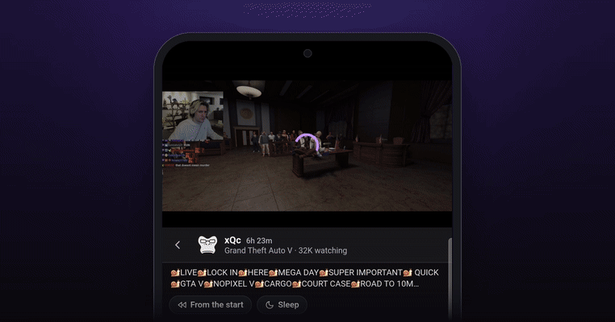
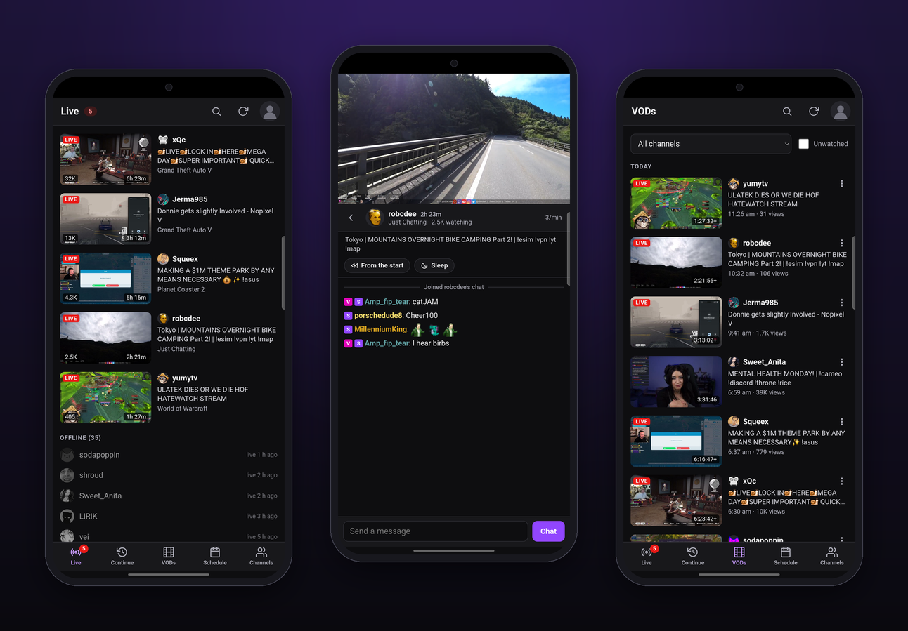

# Lurk

An unofficial Android client for Twitch: the channels you follow, who is live, the stream, and chat. It is the phone
companion to [Twitch Desktop](https://github.com/Brownaye/twitch-desktop) and signs in the same way.

Unofficial. Not affiliated with or endorsed by Twitch.

<p align="center">
  
</p>

<p align="center">
  
</p>

## What it does

- **Live.** The channels you follow that are live, with thumbnail, title, category, viewers and uptime, then
  everyone who is offline. Favourites come first. Checked every minute while the app is open.
- **Watch with chat.** Tap a stream: the video plays at the top and chat runs underneath. Turn the phone sideways
  and the video fills the screen. "From the start" plays the recording of a live stream from 0:00.
- **Swipe to the next channel.** A quick swipe left or right, over the video or the chat, goes to the next or
  previous live channel. The one you left stays loaded for a minute and the next one is loaded ahead, so flicking
  through does not wait for each stream to start.
- **Chat.** Reads as you and lets you type when signed in. Shows Twitch emotes plus 7TV, BetterTTV and
  FrankerFaceZ emotes.
- **Search.** Find any channel on Twitch by name. Watch it if it is live, or add it to your channels without
  following it on Twitch.
- **Hearts.** Give a channel a heart and, when it goes live while you are watching something else, a card slides
  in over the video for 10 seconds with a Switch now button. It waits a few minutes after they go live, so the
  "starting soon" screen is over.
- **Alerts.** A notification when a favourite or a channel with a heart goes live, also with the app closed
  (checked about every 15 minutes then). Tap it to open the stream. Off until you turn it on in Settings.
- **Screen off.** The stream carries on with the screen off, with a notification to stop it.
- **Picture-in-picture.** Leave the app while watching and the video carries on in a small window.
- **Sleep timer.** Stops the video after a while, or at the end of a past broadcast. The sound fades out first.
- **Continue.** Past broadcasts you stopped partway through, and live streams you watched for a minute or more and
  then left (rejoin them, or catch up from where you left).
- **VODs.** Past broadcasts from every channel you follow, by day, with your progress in each. Filter by channel
  or favourites, or show only what you have not watched.
- **Schedule.** What the channels you follow have planned for the next 7 days.
- **Channels.** Everyone you follow and anyone you added from search, when they were last live, your hearts and
  favourites, and your watch time for the week.
- **Sign in with Twitch.** Device code sign-in with a public client ID, so there is no secret in the app. The
  sign-in page opens inside the app, which also logs the player in, so your subscriptions apply.

Not there yet: reminders for scheduled streams.

## Install

Download [lurk.apk](../../releases/latest/download/lurk.apk) on the phone and open it. Android
asks you to allow installing from this source the first time, because the app is not from the Play Store. Needs
Android 11 or newer.

With the phone plugged in to a computer instead: `adb install -r lurk.apk`.

There is no auto-update. To update, install the newer APK over the old one; your sign-in and history stay.

## Privacy

Your sign-in, hearts, favourites and watch history are kept in the app's private storage on the phone. The app
talks to Twitch, and to 7TV, BetterTTV and FrankerFaceZ for chat emotes. There is no analytics, no account of
its own and no server behind it.

What Android lists the app as able to do, and why:

- **Notifications:** alerts, and the "now playing" notification. Asked for only when you turn alerts on.
- **Run in the background, keep the phone awake:** only while a stream is playing, so it carries on with the
  screen off.
- **Run at startup:** so the check for who went live survives a restart. It does nothing unless alerts are on.

## Build

Needs JDK 17, the Android SDK (platform 35) and Gradle 8.9 or newer. There is no Gradle wrapper in the repo.

```
echo "sdk.dir=/path/to/Android/Sdk" > local.properties
gradle assembleDebug
adb install -r app/build/outputs/apk/debug/app-debug.apk
```

A build of your own is signed with your own key, so it will not install over a release from here (uninstall that
first). For a signed release build, put `storeFile`, `storePassword`, `keyAlias` and `keyPassword` in a
`keystore.properties` file next to `build.gradle` and run `gradle assembleRelease`.

## How it is put together

A plain Java activity with two web views and no other dependencies:

- `app/src/main/java/.../MainActivity.java`: the window. One web view is the app's own pages, the other shows
  `player.twitch.tv` above them and doubles as the browser for Twitch's sign-in page. It also makes the HTTPS
  requests the pages ask for (Twitch and the three emote services only).
- `app/src/main/assets/www/core.js`: storage, sign-in, and the Twitch API calls behind the Live list.
- `app/src/main/assets/www/data.js`: favourites and settings, watch history, past broadcasts and schedules.
- `app/src/main/assets/www/chat.js`: chat over Twitch IRC, and emotes.
- `app/src/main/assets/www/app.js`: the screens.
- `PlaybackService.java` keeps a stream going with the screen off, `LiveCheckJob.java` is the check for who went
  live while the app is closed, `Alerts.java` posts the notifications and `Store.java` holds the sign-in where
  that check can read it.

## Licence

MIT. See [LICENSE](LICENSE).
